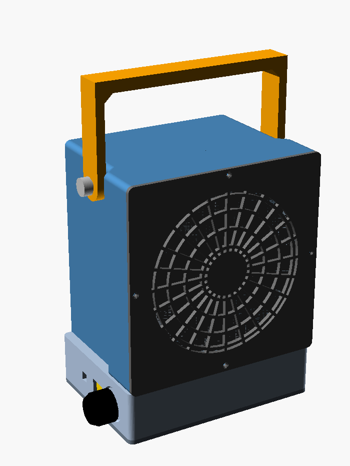
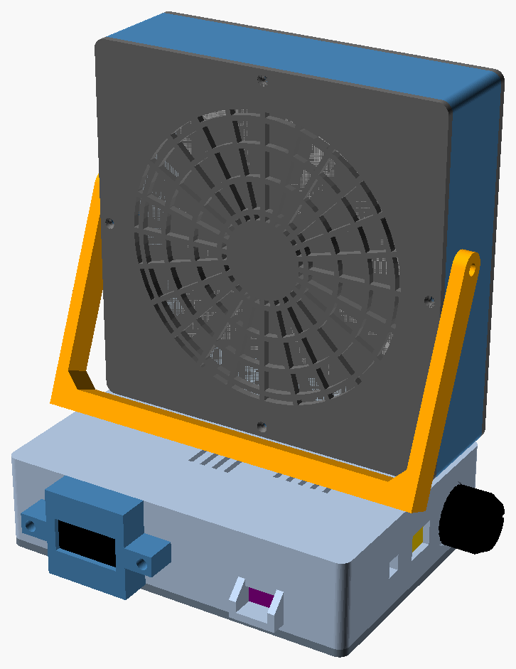
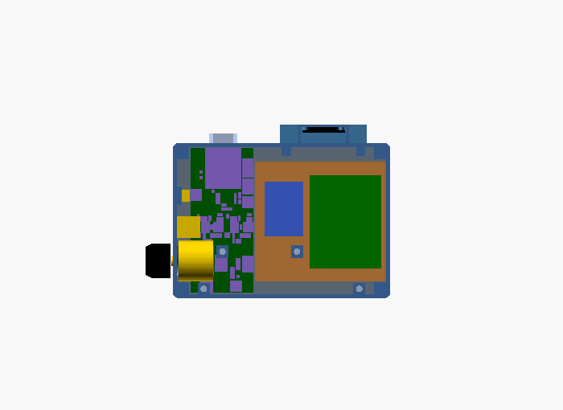
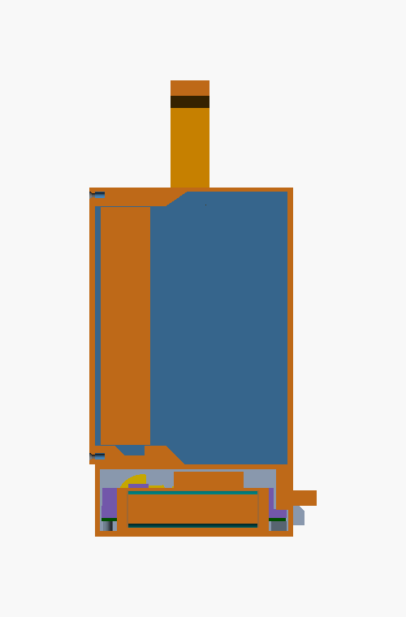

# Table Fan – 120 mm Noctua Portable / Hanging Fan

3D-printable enclosure + electronics for a rechargeable desk/truck fan based on the Noctua NF-F12 industrialPPC-3000 PWM.

## Current Status
- **Mechanical**: Design pass 3 (2026-10-18, after the design review).
  - The fan sits in a shallow head with a grille front and back, and nothing else behind it.
  - Under the head, a base runs back behind it. It holds the 4S pack (cells side by side, axes front to back), the BMS, charger, bucks and Zero carrier.
  - Dial, charge port and screen button are on the base's left (+X) wall; the OLED pod and the Zero's USB-C are on its back.
  - A U-bail on the head carries it or hangs it.
  - Every part renders manifold, and `tools/check_geometry.py` checks the fits. Nothing has been printed yet.
  - Review 2 (2026-10-19) readied it for printing: the fan cable has a path, the charger is vented, the button and pot mounts are stronger, the fit allows for ASA's shrink, and there are test prints. **Start with [docs/PRINTING.md](docs/PRINTING.md)**: what to print first, settings, and what to order now. Then [docs/BUILD.md](docs/BUILD.md) takes it from printed parts to a running fan.
- **Electronics**: Fully documented BOM, pinout, wiring diagram (SVG schematic). Parts ordered Oct 17, 2026.
- **Firmware**: MicroPython in `firmware/`.
- **Next**: measure the parts as they arrive ("Verify on arrival" in the electronics doc), print, bench-test.

| Front, bail up | Back, bail swung onto the base |
|---|---|
|  |  |

| Base from above (back at the top, knob on the left = +X) | Cut through the middle |
|---|---|
|  |  |

In the base: the sled's lid (brown) carries the BMS (green) and the 12 V buck (blue). The charger and the 5 V buck (blue) sit on the plate, with the Zero carrier (purple) at the back and the pot, USB-C socket and button (gold) on the +X wall. Rendered from `models/assembly.scad` (`view` = full, base_layout, cutaway).

## Folder Structure
```
table-fan/
├── README.md
├── docs/
│   ├── DESIGN_OVERVIEW.md
│   ├── PRINTING.md           ← print order, settings, inserts, what to order
│   └── BUILD.md              ← assembly, wiring cut list, first power-up, calibration
├── models/
│   ├── fan_housing.scad      ← head, base, bottom plate, OLED pod
│   ├── battery_sled.scad     ← 4×18650 sled + lid (the BMS sits on the lid)
│   ├── bail.scad             ← carry / hanging bail
│   ├── faceplate.scad        ← front and rear grille (print two)
│   ├── knob.scad             ← backup dial knob (aluminum knob ships with pot)
│   ├── assembly.scad         ← everything assembled, for looking at
│   ├── test_prints.scad      ← quick fit tests: inserts, fan, side wall, sled end
│   └── checks.scad           ← fit checks, run by tools/check_geometry.py
├── tools/
│   ├── check_geometry.py
│   └── slice.py              ← G-code for an Ender-3 Neo, in PLA
├── slicing/
│   ├── ender3-neo-pla.ini    ← PrusaSlicer configs (Creality profile + this project's settings)
│   └── ender3-neo-petg.ini
├── firmware/
└── electronics/
    ├── ELECTRONICS_BOM_AND_WIRING.md
    └── wiring_diagram.svg    ← visual schematic
```

## How to Generate STLs
1. Install [OpenSCAD](https://openscad.org/) (free; 2021.01 or later).
2. Each part renders in its print orientation, chosen by a variable at the top of its file (or `-D` on the command line). None needs supports.

   | Part | File | Variable | On the bed |
   |------|------|----------|------------|
   | Head | `fan_housing.scad` | `part = "head"` | rear face down |
   | Base | `fan_housing.scad` | `part = "base"` | upside down |
   | Bottom plate | `fan_housing.scad` | `part = "plate"` | flat |
   | OLED pod | `fan_housing.scad` | `part = "pod"` | window down |
   | Sled, lid | `battery_sled.scad` | `sled_part = "print_sled"`, `"print_lid"` | base down, flat |
   | Bail | `bail.scad` | `bail_part = "print"` | flat |
   | Faceplate (×2) | `faceplate.scad` | – | flat |
   | Knob (backup) | `knob.scad` | – | flat |
   | Test prints | `test_prints.scad` | `test = "inserts"`, `"fan_fit"`, `"side_wall"`, `"sled_end"` | as rendered |

   Or run `python3 tools/check_geometry.py --stl stl`: it checks everything and writes every STL, test prints included, to `stl/`.
   For a Creality Ender-3 Neo, `python3 tools/slice.py --prusaslicer /path/to/prusa-slicer` writes ready G-code for all seven plates in PLA (`--material petg` for PETG); see [docs/PRINTING.md](docs/PRINTING.md).
3. Slice in your preferred slicer. This build is **PLA**. It softens at about 55–60 °C, so keep the finished fan out of a hot parked cab; PETG or ASA would take the heat with the same files. Settings and the print order are in [docs/PRINTING.md](docs/PRINTING.md).

## Checking the geometry
`python3 tools/check_geometry.py` renders every part and 17 fit checks with OpenSCAD and prints PASS/FAIL. It takes about a minute on 16 cores. What it checks:
- the fan's intake is clear;
- the fan fits and bears on its ledges;
- the cells fit the sled, and the sled, boards, dial, charge port and button fit the base without touching each other;
- the openings go through: charge port, button, Zero plug, vents, and the fan cable's slot and floor groove;
- a press on the button bears on a floor, not on glue;
- the bail swings from up to rest without hitting anything;
- there is material round every insert pilot;
- every part is manifold, read from its exported mesh (so any OpenSCAD version gives the same answer).

Run it after changing any dimension. `--self-test` breaks each check on purpose, to prove each one can fail. `--overhangs` lists every bridge and overhang each part will print, and estimates its filament.

## Key Design Features
- Fits a standard 120 × 120 × 25 mm fan: four M3 bolts through its corner holes into nuts on ledges behind it
- Grilles front and rear (the same part, print two), each on 4× M2 screws into heat-set inserts
- Base: the 4S1P pack boxed in a sled with the BMS on its lid, the charger, two MP1584 bucks and the Zero carrier. Take the bottom plate off and everything is in reach
- Vent slots over the charger and the 12 V buck, behind the head, where the fan's intake draws air past them; zip-tie bridges on the bottom plate
- A groove across the fan cavity's floor leads the fan's cable from its corner to the slot into the base
- Dial (speed + hard power), USB-C charge port and screen button on the left (+X) side
- OLED pod and the Zero's USB-C (programming port) on the back
- U-bail: carry handle or wall-hook hanger; swings back onto the base when not in use
- About 140 × 177 × 100 mm (W × H × D), plus the knob and the rear pod

## Assembly Order
1. Heat-set inserts:
   - head: M2 ×8 (front and rear faces) and M4 ×2 (sides);
   - base: M3 ×8 (4 in its top surface, 4 in its corner bosses underneath).
2. Head onto the base: 4× M3 × 16 countersunk, from inside the fan cavity down into the base.
3. Fan:
   - Turn it so its cable leaves at a bottom corner. Feed the plug down through the slot in the floor and lay the cable in the floor groove.
   - Put it in with the airflow arrow pointing out of the front.
   - Fix it with 4× M3 × 30 from the front through its corner holes, with the nuts in the pockets on the ledges behind.
4. Faceplates, front and rear: M2 × 6.
5. Electronics on the bottom plate and the sled (electronics doc), then the plate: 4× M3 × 8 countersunk.
6. Bail: an M4 × 12 each side, with a steel washer under its head and a nylon washer between the arm and the head. Tighten until it holds its angle.

Truck vibration backs screws out of printed parts. Put a plastic-safe threadlocker (e.g. Vibra-TITE VC-3) on the fan bolts and the faceplate and bail screws. It still lets you adjust the bail.
