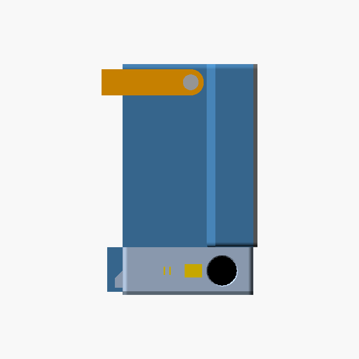

# Table Fan – 120 mm Noctua Portable / Hanging Fan

3D-printable enclosure + electronics for a rechargeable desk/truck fan based on the Noctua NF-F12 industrialPPC-3000 PWM.

## Current Status
- **Mechanical**: Design pass 4 (2026-10-20: a deeper head, and a bail that locks and folds flush).
  - The fan sits at the front of the head, in a full-width frame with a grille. Behind it, a duct runs back to the base's rear face and is closed by a grille printed with the head; nothing else is behind the fan.
  - Under the head, the base holds the 4S pack (cells side by side, axes front to back), the BMS and charger on the sled's lid, and the carrier + PSU board (the Zero and both bucks).
  - Dial, charge port and screen button are on the base's left (+X) wall; the OLED pod and the Zero's USB-C are on its back.
  - A U-bail on the head carries it or hangs it, with 46 mm of hook room over the top. Teeth round its pivots lock it every 15°, clamped by thumb screws, and folded, its arms lie flush in recesses along the duct's sides.
  - Every part renders manifold, and `tools/check_geometry.py` checks the fits. The test prints are the first parts printed.
  - Review 2 (2026-10-19) readied it for printing: the fan cable has a path, the charger is vented, the button and pot mounts are stronger, the fit allows for ASA's shrink, and there are test prints. **Start with [docs/PRINTING.md](docs/PRINTING.md)**: what to print first, settings, and what to order now. Then [docs/BUILD.md](docs/BUILD.md) takes it from printed parts to a running fan.
- **Electronics**: Fully documented BOM, pinout, wiring diagram (SVG schematic). Parts ordered Oct 17, 2026.
  - The carrier + PSU board v2.1 ([electronics/pcb/](electronics/pcb/README.md)) replaces the perfboard and the MP1584 modules: the Zero, both bucks and a connector for every lead on one board. Gerbers are ready to order, checked by `tools/check_pcb.py`. (v2's Gerbers were mirrored: don't order them.)
- **Firmware**: MicroPython in `firmware/`.
- **Next**: measure the parts as they arrive ("Verify on arrival" in the electronics doc), order the board, print, bench-test.

| Front, bail up | Back, bail folded | Side, bail folded flush |
|---|---|---|
|  |  |  |

| Base from above (back at the top, knob on the left = +X) | Cut through the middle |
|---|---|
|  |  |

In the base: the sled's lid (brown) carries the BMS (green) and the charger (blue). Beside the sled, the carrier + PSU board (dark green, its parts purple) sits on the plate with the Zero at the back, and the pot, USB-C socket and button (gold) are on the +X wall. Rendered from `models/assembly.scad` (`view` = full, base_layout, cutaway).

## Folder Structure
```
table-fan/
├── README.md
├── docs/
│   ├── DESIGN_OVERVIEW.md
│   ├── PRINTING.md           ← print order, settings, inserts, what to order
│   └── BUILD.md              ← assembly, wiring cut list, first power-up, calibration
├── models/
│   ├── fan_housing.scad      ← head, base, bottom plate, OLED pod
│   ├── carrier_pcb.scad      ← the board's outline, holes and parts (generated by tools/check_pcb.py)
│   ├── battery_sled.scad     ← 4×18650 sled + lid (the BMS sits on the lid)
│   ├── bail.scad             ← carry / hanging bail; locks every 15°, folds flush
│   ├── faceplate.scad        ← front grille (the rear one is part of the head)
│   ├── knob.scad             ← backup dial knob (aluminum knob ships with pot)
│   ├── assembly.scad         ← everything assembled, for looking at
│   ├── test_prints.scad      ← quick fit tests: inserts, fan, bail joint, side wall, sled end
│   └── checks.scad           ← fit checks, run by tools/check_geometry.py
├── tools/
│   ├── check_geometry.py
│   ├── check_pcb.py          ← the board's fab rules, netlist and fit, from its Gerbers
│   └── slice.py              ← G-code for an Ender-3 Neo, in PLA
├── slicing/
│   ├── ender3-neo-pla.ini    ← PrusaSlicer configs (Creality profile + this project's settings)
│   └── ender3-neo-petg.ini
├── firmware/
└── electronics/
    ├── ELECTRONICS_BOM_AND_WIRING.md
    ├── wiring_diagram.svg    ← visual schematic
    └── pcb/                  ← carrier + PSU board: carrier-psu.tsx (tscircuit), gerber/, assembly.png
```

## How to Generate STLs
1. Install [OpenSCAD](https://openscad.org/) (free; 2021.01 or later).
2. Each part renders in its print orientation, chosen by a variable at the top of its file (or `-D` on the command line). None needs supports.

   | Part | File | Variable | On the bed |
   |------|------|----------|------------|
   | Head | `fan_housing.scad` | `part = "head"` | rear face down |
   | Base | `fan_housing.scad` | `part = "base"` | upside down |
   | Bottom plate | `fan_housing.scad` | `part = "plate"` | flat |
   | OLED pod | `fan_housing.scad` | `part = "pod"` | window down |
   | Sled, lid | `battery_sled.scad` | `sled_part = "print_sled"`, `"print_lid"` | base down, flat |
   | Bail | `bail.scad` | `bail_part = "print"` | flat |
   | Faceplate (front) | `faceplate.scad` | – | flat |
   | Knob (backup) | `knob.scad` | – | flat |
   | Test prints | `test_prints.scad` | `test = "inserts"`, `"fan_fit"`, `"bail_joint"`, `"side_wall"`, `"sled_end"` | as rendered |

   Or run `python3 tools/check_geometry.py --stl stl`: it checks everything and writes every STL, test prints included, to `stl/`.
   For a Creality Ender-3 Neo, `python3 tools/slice.py --prusaslicer /path/to/prusa-slicer` writes ready G-code for all nine plates in PLA (`--material petg` for PETG); see [docs/PRINTING.md](docs/PRINTING.md).
3. Slice in your preferred slicer. This build is **PLA**. It softens at about 55–60 °C, so keep the finished fan out of a hot parked cab; PETG or ASA would take the heat with the same files. Settings and the print order are in [docs/PRINTING.md](docs/PRINTING.md).

## Checking the geometry
`python3 tools/check_geometry.py` renders every part and 22 fit checks with OpenSCAD and prints PASS/FAIL. It takes about five minutes on 16 cores. What it checks:
- the fan's intake is clear;
- the fan fits, bears on its corner columns, and its bolts reach their inserts;
- the cells fit the sled, and the sled, boards, dial, charge port and button fit the base without touching each other;
- the carrier + PSU board bears on the plate's bosses, and each boss is whole;
- the openings go through: charge port, button, Zero plug, vents, and the fan cable's slot and floor groove;
- a press on the button bears on a floor, not on glue;
- the bail swings from up to folded without hitting anything, its teeth mesh at every 15° step and bear when clamped, it folds flush with the sides, and it leaves at least 40 mm of hook room;
- there is material round every insert pilot;
- every part is manifold, read from its exported mesh (so any OpenSCAD version gives the same answer).

Run it after changing any dimension. `--self-test` breaks each check on purpose, to prove each one can fail. `--overhangs` lists every bridge and overhang each part will print, and estimates its filament.

## Checking the board
`python3 tools/check_pcb.py` reads the carrier + PSU board's Gerbers and checks them against JLCPCB's 2-layer rules, against the circuit (no opens, no shorts), for parts that collide, and for fit in the base under the pot, the sockets and the roof. `--self-test` breaks each check on purpose. Building and ordering the board: [electronics/pcb/README.md](electronics/pcb/README.md).

## Key Design Features
- Fits a standard 120 × 120 × 25 mm fan: four M3 bolts through its corner holes into heat-set inserts in four corner columns behind it
- A grille in front on 4× M2 screws into heat-set inserts; the same pattern closes the duct at the back, printed with the head
- Base: the 4S1P pack boxed in a sled with the BMS and the charger on its lid, and beside it the carrier + PSU board with the Zero and both MP1584 bucks. Take the bottom plate off and everything is in reach
- Vent slots over the charger and the board's 12 V buck open into the duct, so the fan draws air past them; every lead plugs into the board, so the bottom plate needs only one zip-tie bridge
- A groove across the fan cavity's floor leads the fan's cable from its corner to the slot into the base
- Dial (speed + hard power), USB-C charge port and screen button on the left (+X) side
- OLED pod and the Zero's USB-C (programming port) on the back
- U-bail: carry handle or hook hanger with 46 mm of hook room. It locks every 15° (teeth clamped by thumb screws), so hung up it can point level or tip down to about 36°, and it folds flush along the duct's sides
- About 140 × 177 × 100 mm (W × H × D), plus the knob and the rear pod

## Assembly Order
1. Heat-set inserts:
   - head: M2 ×4 (front face), M3 ×4 (the corner columns' front faces, 28 mm into the cavity), M3 ×2 (underneath, at the back) and M4 ×2 (the side recesses);
   - base: M3 ×8 (4 in its top surface, 4 in its corner bosses underneath).
2. Head onto the base: 4× M3 × 16 countersunk, from inside the fan cavity down into the base, and 2× M3 × 8 pan head from inside the base, up through its roof into the head's rear inserts.
3. Fan:
   - Turn it so its cable leaves at a bottom corner. Feed the plug down through the slot in the floor and lay the cable in the floor groove.
   - Put it in with the airflow arrow pointing out of the front.
   - Fix it with 4× M3 × 30 from the front through its corner holes into the columns' inserts.
4. Faceplate on the front: M2 × 6.
5. Electronics on the bottom plate and the sled's lid (electronics doc): the carrier + PSU board on 8× M2 × 6. Then the plate: 4× M3 × 8 countersunk.
6. Bail: an M4 × 16 thumb screw each side, through a washer and the arm into the pivot insert, with the arm's teeth against the wall's. Hand-tight locks it; loosen about two turns to move it a step.

Truck vibration backs screws out of printed parts. Put a plastic-safe threadlocker (e.g. Vibra-TITE VC-3) on the fan bolts and the faceplate screws, but not on the bail's thumb screws, which you turn by hand: an M4 wave washer under each keeps it tight, and check them before a drive.
